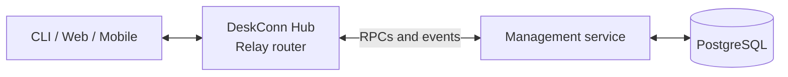

# DeskConn Management

Identity, machine enrollment, and access management for
[DeskConn](https://github.com/xconnio/deskconn).

The service manages accounts, verification, client credentials, machine sharing,
and invitations. Built with Python and [XConn](https://github.com/xconnio/xconn),
it exposes RPCs through the DeskConn Hub and stores application data in PostgreSQL.

## Responsibilities

- **Accounts:** registration, email verification, login verification, and password reset.
- **Credentials:** register and remove client devices and public-key principals.
- **Machines:** enroll, list, update, and detach machines.
- **Access:** manage machine roles, sharing, and invitations.
- **Hub integration:** answer authentication and access checks, manage machine
  realms, and publish credential and access updates.

## How it fits



Management connects to the Hub's shared `io.xconn.deskconn` realm using
CryptoSign. The Hub routes application traffic and enforces its connection and
procedure permissions; Management provides account and access data.

## Local development

Use Python 3.12 or newer, uv, Make, and Docker Compose for the local database.
Start with a working [DeskConn Hub](https://github.com/xconnio/deskconn-hub)
deployment and matching service credentials.

```sh
make setup
```

This creates `.venv`, installs the service and test dependencies, and copies
`example.env` to `.env`. Edit `.env` for the database, Hub connection, and email
settings before continuing:

```sh
make db
make run
```

`make db` starts PostgreSQL, initializes the database roles, and applies Alembic
migrations. The service uses the published XConn Python package; supported wheels
include the native runtime, so normal installation needs neither Rust nor a
sibling XConn checkout.

See [configuration and deployment](docs/deployment.md) for connection URLs,
CryptoSign credentials, email settings, Docker, and migrations.

## Checks

```sh
make lint
make test
```

`make format` applies formatting. See [testing](docs/testing.md) for test scope
and the optional real-router integration test.
